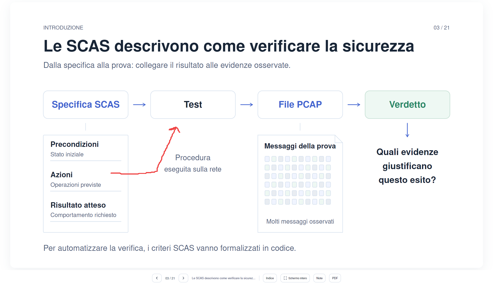
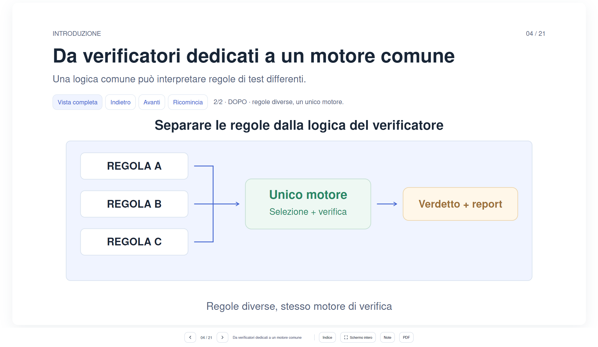
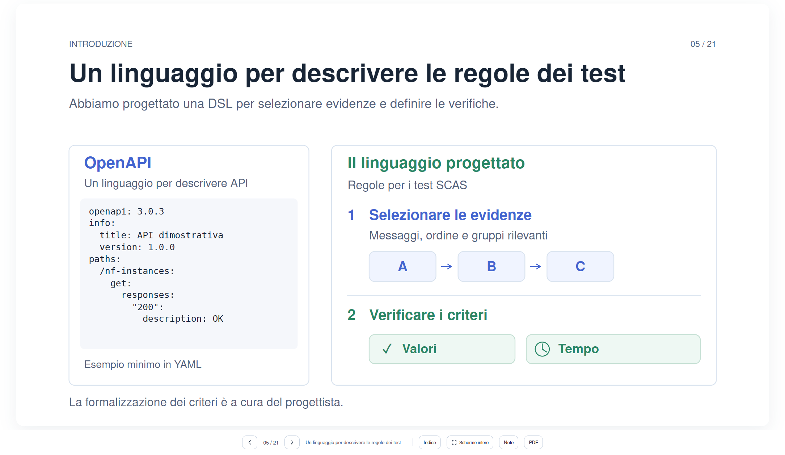
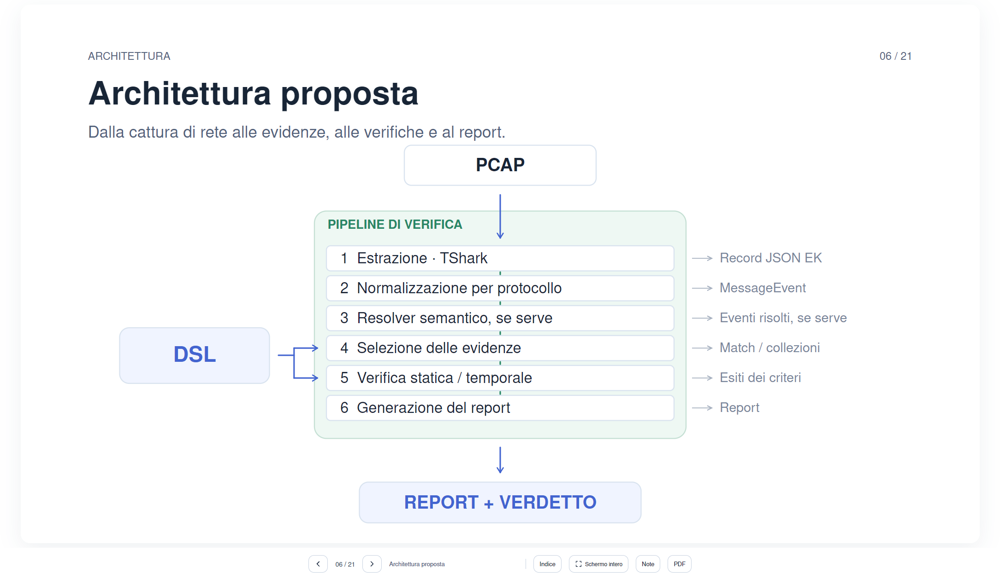
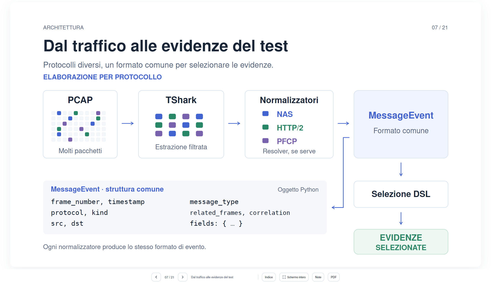
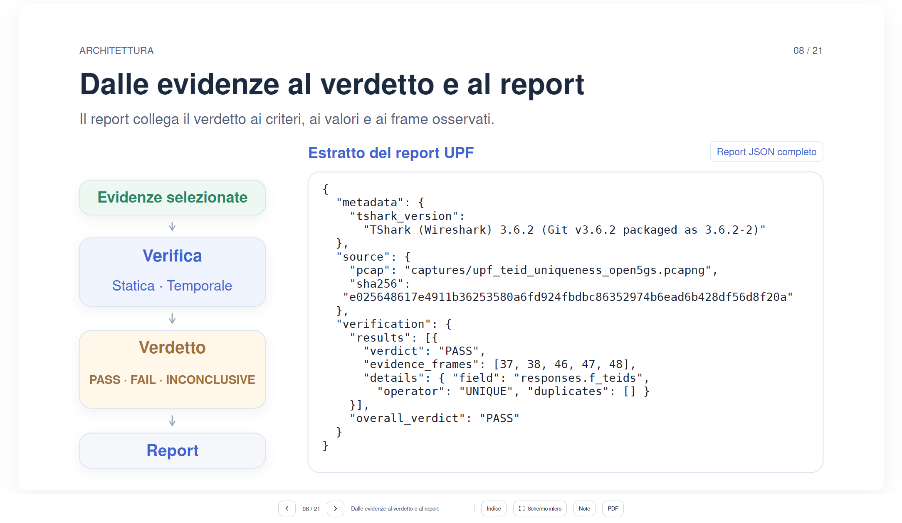
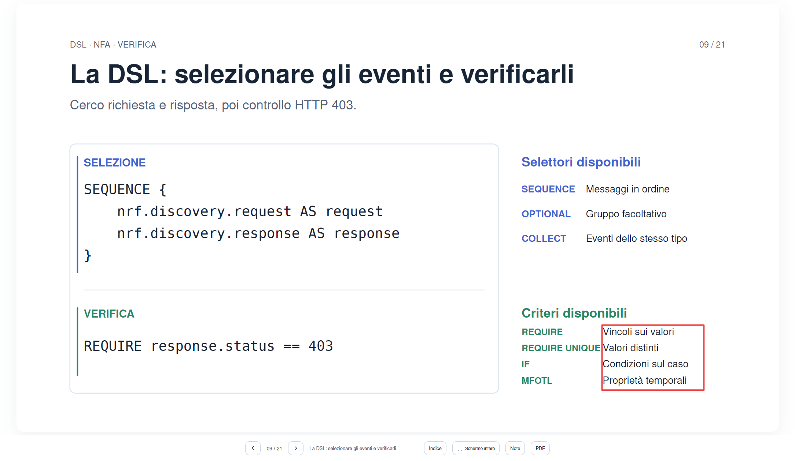
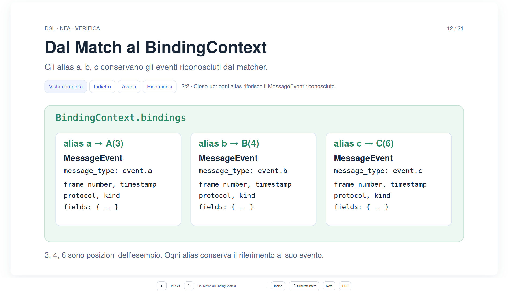
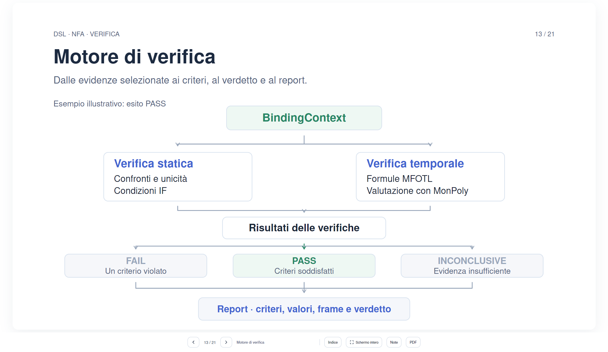

> Report della versione 6, applicato nella versione 7. I numeri nelle richieste sono quelli precedenti alla fusione delle slide 7 e 8. La mappa aggiornata è in MODIFICA_SLIDE.md.

# 🚀 Report Revisione UI (Generato da Visual AI Bug Tracker)

**Data Sessione:** 16/10/2026 - 16:19:16
**Totale Bug Rilevati:** 9

---

## 🐛 Bug #1: Desktop
* **Rotta / URL:** `file:///C:/Users/samu1/Downloads/Presentazione_5G_revisionata_v6/5g-thesis-presentation/index.html#slide-3`
* **Dispositivo / Viewport:** Desktop
* **Ora scatto:** 16:11:08

### 📝 Descrizione del Problema:
> forse metterei la freccia tra azioni e test, idealmente poi non so, sposterei anche "Molti messaggi osservati" poco piu  in alto e quindi mettere il file leggermente più piccolo

### 📸 Riferimento Visivo Annotato:


<details>
<summary>🔎 Clicca per espandere il Frammento HTML / DOM</summary>

```html
<main id="viewport" aria-label="Presentazione della tesi 5G">
      <div id="deck">
        
        <!-- SLIDE 1: titolo — contenuto e geometria modificabili qui. -->
  <section class="slide" id="slide-1" data-title="Titolo della tesi" data-seconds="20" aria-label="1 di 21: Titolo della tesi" data-slide-key="titolo" aria-hidden="true" hidden="">
  <svg xmlns="http://www.w3.org/2000/svg" viewBox="0 0 1600 900" width="1600" height="900" role="img" aria-labelledby="title-1">
  <title id="title-1">Titolo della tesi</title>
  <defs>
  <filter id="shadow-1" x="-20%" y="-40%" width="140%" height="180%">
  <feDropShadow dx="0" dy="7" stdDeviation="11" flood-color="#203653" flood-opacity=".055"></feDropShadow>
  </filter>
  <marker id="arrow-1-gray" markerUnits="userSpaceOnUse" viewBox="0 0 14 14" refX="11" refY="7" markerWidth="14" markerHeight="14" orient="auto">
  <path d="M3 2 L11 7 L3 12" fill="none" stroke="#99a7bb" stroke-width="2" stroke-linecap="round" stroke-linejoin="round" class="stroke-gray"></path>
  </marker>
  <marker id="arrow-1-blue" markerUnits="userSpaceOnUse" viewBox="0 0 14 14" refX="11" refY="7" markerWidth="14" markerHeight="14" orient="auto">
  <path d="M3 2 L11 7 L3 12" fill="none" stroke="#4264d0" stroke-width="2" stroke-linecap="round" stroke-linejoin="round" class="stroke-blue"></path>
  </marker>
  <marker id="arrow-1-green" markerUnits="userSpaceOnUse" viewBox="0 0 14 14" refX="11" refY="7" markerWidth="14" markerHeight="14" orient="auto">
  <path d="M3
```
</details>

---

## 🐛 Bug #2: Desktop
* **Rotta / URL:** `file:///C:/Users/samu1/Downloads/Presentazione_5G_revisionata_v6/5g-thesis-presentation/index.html#slide-4`
* **Dispositivo / Viewport:** Desktop
* **Ora scatto:** 16:12:43

### 📝 Descrizione del Problema:
> Qui sposterei "regole diverse..." e anche la frase su 1/2 poco piú sopra ; una cosa poco bella è che Unico Motore e Verdetto + report compaiono dopo mentre tipo Selezione + Verifica compare prima, prova a farli comparire tutti e tre insieme (possibilmente lascia Seleizone + verifica con i tempi attuali e modifica gli altri due
>
> **Precisazione operativa:** Quando compare la seconda configurazione, «Selezione + verifica», «Unico motore» e «Verdetto + report» devono diventare visibili contemporaneamente. Mantieni esattamente il momento in cui appare attualmente «Selezione + verifica» e anticipa gli altri due elementi a quello stesso istante. Non modificare l’animazione che sostituisce la configurazione precedente con quella nuova: il vecchio schema deve scomparire, senza rimanere visibile insieme al nuovo.

### 📸 Riferimento Visivo Annotato:


<details>
<summary>🔎 Clicca per espandere il Frammento HTML / DOM</summary>

```html
<main id="viewport" aria-label="Presentazione della tesi 5G">
      <div id="deck">
        
        <!-- SLIDE 1: titolo — contenuto e geometria modificabili qui. -->
  <section class="slide" id="slide-1" data-title="Titolo della tesi" data-seconds="20" aria-label="1 di 21: Titolo della tesi" data-slide-key="titolo" aria-hidden="true" hidden="">
  <svg xmlns="http://www.w3.org/2000/svg" viewBox="0 0 1600 900" width="1600" height="900" role="img" aria-labelledby="title-1">
  <title id="title-1">Titolo della tesi</title>
  <defs>
  <filter id="shadow-1" x="-20%" y="-40%" width="140%" height="180%">
  <feDropShadow dx="0" dy="7" stdDeviation="11" flood-color="#203653" flood-opacity=".055"></feDropShadow>
  </filter>
  <marker id="arrow-1-gray" markerUnits="userSpaceOnUse" viewBox="0 0 14 14" refX="11" refY="7" markerWidth="14" markerHeight="14" orient="auto">
  <path d="M3 2 L11 7 L3 12" fill="none" stroke="#99a7bb" stroke-width="2" stroke-linecap="round" stroke-linejoin="round" class="stroke-gray"></path>
  </marker>
  <marker id="arrow-1-blue" markerUnits="userSpaceOnUse" viewBox="0 0 14 14" refX="11" refY="7" markerWidth="14" markerHeight="14" orient="auto">
  <path d="M3 2 L11 7 L3 12" fill="none" stroke="#4264d0" stroke-width="2" stroke-linecap="round" stroke-linejoin="round" class="stroke-blue"></path>
  </marker>
  <marker id="arrow-1-green" markerUnits="userSpaceOnUse" viewBox="0 0 14 14" refX="11" refY="7" markerWidth="14" markerHeight="14" orient="auto">
  <path d="M3
```
</details>

---

## 🐛 Bug #3: Desktop
* **Rotta / URL:** `file:///C:/Users/samu1/Downloads/Presentazione_5G_revisionata_v6/5g-thesis-presentation/index.html#slide-5`
* **Dispositivo / Viewport:** Desktop
* **Ora scatto:** 16:13:35

### 📝 Descrizione del Problema:
> qui mi inizia a piacere un po' di più ma OpenAPI a sx da un'idea sbagliata perché sempre il focus quando in realtà è un esempio a supporto del nostro linguaggio

### 📸 Riferimento Visivo Annotato:


<details>
<summary>🔎 Clicca per espandere il Frammento HTML / DOM</summary>

```html
<main id="viewport" aria-label="Presentazione della tesi 5G">
      <div id="deck">
        
        <!-- SLIDE 1: titolo — contenuto e geometria modificabili qui. -->
  <section class="slide" id="slide-1" data-title="Titolo della tesi" data-seconds="20" aria-label="1 di 21: Titolo della tesi" data-slide-key="titolo" aria-hidden="true" hidden="">
  <svg xmlns="http://www.w3.org/2000/svg" viewBox="0 0 1600 900" width="1600" height="900" role="img" aria-labelledby="title-1">
  <title id="title-1">Titolo della tesi</title>
  <defs>
  <filter id="shadow-1" x="-20%" y="-40%" width="140%" height="180%">
  <feDropShadow dx="0" dy="7" stdDeviation="11" flood-color="#203653" flood-opacity=".055"></feDropShadow>
  </filter>
  <marker id="arrow-1-gray" markerUnits="userSpaceOnUse" viewBox="0 0 14 14" refX="11" refY="7" markerWidth="14" markerHeight="14" orient="auto">
  <path d="M3 2 L11 7 L3 12" fill="none" stroke="#99a7bb" stroke-width="2" stroke-linecap="round" stroke-linejoin="round" class="stroke-gray"></path>
  </marker>
  <marker id="arrow-1-blue" markerUnits="userSpaceOnUse" viewBox="0 0 14 14" refX="11" refY="7" markerWidth="14" markerHeight="14" orient="auto">
  <path d="M3 2 L11 7 L3 12" fill="none" stroke="#4264d0" stroke-width="2" stroke-linecap="round" stroke-linejoin="round" class="stroke-blue"></path>
  </marker>
  <marker id="arrow-1-green" markerUnits="userSpaceOnUse" viewBox="0 0 14 14" refX="11" refY="7" markerWidth="14" markerHeight="14" orient="auto">
  <path d="M3
```
</details>

---

## 🐛 Bug #4: Desktop
* **Rotta / URL:** `file:///C:/Users/samu1/Downloads/Presentazione_5G_revisionata_v6/5g-thesis-presentation/index.html#slide-6`
* **Dispositivo / Viewport:** Desktop
* **Ora scatto:** 16:14:00

### 📝 Descrizione del Problema:
> qui forse leverei il sottotitolo perchè é troppo attaccato a PCPA

### 📸 Riferimento Visivo Annotato:


<details>
<summary>🔎 Clicca per espandere il Frammento HTML / DOM</summary>

```html
<main id="viewport" aria-label="Presentazione della tesi 5G">
      <div id="deck">
        
        <!-- SLIDE 1: titolo — contenuto e geometria modificabili qui. -->
  <section class="slide" id="slide-1" data-title="Titolo della tesi" data-seconds="20" aria-label="1 di 21: Titolo della tesi" data-slide-key="titolo" aria-hidden="true" hidden="">
  <svg xmlns="http://www.w3.org/2000/svg" viewBox="0 0 1600 900" width="1600" height="900" role="img" aria-labelledby="title-1">
  <title id="title-1">Titolo della tesi</title>
  <defs>
  <filter id="shadow-1" x="-20%" y="-40%" width="140%" height="180%">
  <feDropShadow dx="0" dy="7" stdDeviation="11" flood-color="#203653" flood-opacity=".055"></feDropShadow>
  </filter>
  <marker id="arrow-1-gray" markerUnits="userSpaceOnUse" viewBox="0 0 14 14" refX="11" refY="7" markerWidth="14" markerHeight="14" orient="auto">
  <path d="M3 2 L11 7 L3 12" fill="none" stroke="#99a7bb" stroke-width="2" stroke-linecap="round" stroke-linejoin="round" class="stroke-gray"></path>
  </marker>
  <marker id="arrow-1-blue" markerUnits="userSpaceOnUse" viewBox="0 0 14 14" refX="11" refY="7" markerWidth="14" markerHeight="14" orient="auto">
  <path d="M3 2 L11 7 L3 12" fill="none" stroke="#4264d0" stroke-width="2" stroke-linecap="round" stroke-linejoin="round" class="stroke-blue"></path>
  </marker>
  <marker id="arrow-1-green" markerUnits="userSpaceOnUse" viewBox="0 0 14 14" refX="11" refY="7" markerWidth="14" markerHeight="14" orient="auto">
  <path d="M3
```
</details>

---

## 🐛 Bug #5: Desktop
* **Rotta / URL:** `file:///C:/Users/samu1/Downloads/Presentazione_5G_revisionata_v6/5g-thesis-presentation/index.html#slide-7`
* **Dispositivo / Viewport:** Desktop
* **Ora scatto:** 16:14:43

### 📝 Descrizione del Problema:
> qui mi piace forse la freccia da MessageEvent al blocco la metterei più leggera (non deve essere uguale alle freccia della pipeline)

### 📸 Riferimento Visivo Annotato:


<details>
<summary>🔎 Clicca per espandere il Frammento HTML / DOM</summary>

```html
<main id="viewport" aria-label="Presentazione della tesi 5G">
      <div id="deck">
        
        <!-- SLIDE 1: titolo — contenuto e geometria modificabili qui. -->
  <section class="slide" id="slide-1" data-title="Titolo della tesi" data-seconds="20" aria-label="1 di 21: Titolo della tesi" data-slide-key="titolo" aria-hidden="true" hidden="">
  <svg xmlns="http://www.w3.org/2000/svg" viewBox="0 0 1600 900" width="1600" height="900" role="img" aria-labelledby="title-1">
  <title id="title-1">Titolo della tesi</title>
  <defs>
  <filter id="shadow-1" x="-20%" y="-40%" width="140%" height="180%">
  <feDropShadow dx="0" dy="7" stdDeviation="11" flood-color="#203653" flood-opacity=".055"></feDropShadow>
  </filter>
  <marker id="arrow-1-gray" markerUnits="userSpaceOnUse" viewBox="0 0 14 14" refX="11" refY="7" markerWidth="14" markerHeight="14" orient="auto">
  <path d="M3 2 L11 7 L3 12" fill="none" stroke="#99a7bb" stroke-width="2" stroke-linecap="round" stroke-linejoin="round" class="stroke-gray"></path>
  </marker>
  <marker id="arrow-1-blue" markerUnits="userSpaceOnUse" viewBox="0 0 14 14" refX="11" refY="7" markerWidth="14" markerHeight="14" orient="auto">
  <path d="M3 2 L11 7 L3 12" fill="none" stroke="#4264d0" stroke-width="2" stroke-linecap="round" stroke-linejoin="round" class="stroke-blue"></path>
  </marker>
  <marker id="arrow-1-green" markerUnits="userSpaceOnUse" viewBox="0 0 14 14" refX="11" refY="7" markerWidth="14" markerHeight="14" orient="auto">
  <path d="M3
```
</details>

---

## 🐛 Bug #6: Desktop
* **Rotta / URL:** `file:///C:/Users/samu1/Downloads/Presentazione_5G_revisionata_v6/5g-thesis-presentation/index.html#slide-8`
* **Dispositivo / Viewport:** Desktop
* **Ora scatto:** 16:16:03

### 📝 Descrizione del Problema:
> la transizione mi piace nell'idea ma non nella realizzazione, perché evidenze selezionate si muove bene, poi diventa tutto bianco per un secondo e cambia slide, non possiamo metterla tutta in una slide e facciamo tipo 1/2 come le altre? (magari cambiando proprio le scritte E QUI SE LO FAI NON METTERE "VISTA COMPLETA AVANTI INDIETRO ECC" perché non ha senso
>
> **Precisazione operativa:** Realizza le due fasi all’interno di un’unica slide, non come transizione tra due slide distinte. Nella fase 1 mostra l’arrivo delle «Evidenze selezionate»; nella fase 2 completa la composizione con verifica, verdetto e report. Il passaggio deve essere continuo, senza schermate bianche, svuotamenti momentanei o sovrapposizioni. Usa un indicatore discreto «1/2» e «2/2», ma NON aggiungere controlli locali «Spiega per passi», «Vista completa», «Indietro», «Avanti» o «Ricomincia». Devono restare funzionanti i normali comandi globali della presentazione. Se l’unificazione riduce il numero di slide, aggiorna coerentemente numerazione, indice, navigazione e transizioni successive.

### 📸 Riferimento Visivo Annotato:


<details>
<summary>🔎 Clicca per espandere il Frammento HTML / DOM</summary>

```html
<main id="viewport" aria-label="Presentazione della tesi 5G">
      <div id="deck">
        
        <!-- SLIDE 1: titolo — contenuto e geometria modificabili qui. -->
  <section class="slide" id="slide-1" data-title="Titolo della tesi" data-seconds="20" aria-label="1 di 21: Titolo della tesi" data-slide-key="titolo" aria-hidden="true" hidden="">
  <svg xmlns="http://www.w3.org/2000/svg" viewBox="0 0 1600 900" width="1600" height="900" role="img" aria-labelledby="title-1">
  <title id="title-1">Titolo della tesi</title>
  <defs>
  <filter id="shadow-1" x="-20%" y="-40%" width="140%" height="180%">
  <feDropShadow dx="0" dy="7" stdDeviation="11" flood-color="#203653" flood-opacity=".055"></feDropShadow>
  </filter>
  <marker id="arrow-1-gray" markerUnits="userSpaceOnUse" viewBox="0 0 14 14" refX="11" refY="7" markerWidth="14" markerHeight="14" orient="auto">
  <path d="M3 2 L11 7 L3 12" fill="none" stroke="#99a7bb" stroke-width="2" stroke-linecap="round" stroke-linejoin="round" class="stroke-gray"></path>
  </marker>
  <marker id="arrow-1-blue" markerUnits="userSpaceOnUse" viewBox="0 0 14 14" refX="11" refY="7" markerWidth="14" markerHeight="14" orient="auto">
  <path d="M3 2 L11 7 L3 12" fill="none" stroke="#4264d0" stroke-width="2" stroke-linecap="round" stroke-linejoin="round" class="stroke-blue"></path>
  </marker>
  <marker id="arrow-1-green" markerUnits="userSpaceOnUse" viewBox="0 0 14 14" refX="11" refY="7" markerWidth="14" markerHeight="14" orient="auto">
  <path d="M3
```
</details>

---

## 🐛 Bug #7: Desktop
* **Rotta / URL:** `file:///C:/Users/samu1/Downloads/Presentazione_5G_revisionata_v6/5g-thesis-presentation/index.html#slide-9`
* **Dispositivo / Viewport:** Desktop
* **Ora scatto:** 16:16:49

### 📝 Descrizione del Problema:
> Avendo messo require unique forese conviene spostare le scritte a dx

### 📸 Riferimento Visivo Annotato:


<details>
<summary>🔎 Clicca per espandere il Frammento HTML / DOM</summary>

```html
<main id="viewport" aria-label="Presentazione della tesi 5G">
      <div id="deck">
        
        <!-- SLIDE 1: titolo — contenuto e geometria modificabili qui. -->
  <section class="slide" id="slide-1" data-title="Titolo della tesi" data-seconds="20" aria-label="1 di 21: Titolo della tesi" data-slide-key="titolo" aria-hidden="true" hidden="">
  <svg xmlns="http://www.w3.org/2000/svg" viewBox="0 0 1600 900" width="1600" height="900" role="img" aria-labelledby="title-1">
  <title id="title-1">Titolo della tesi</title>
  <defs>
  <filter id="shadow-1" x="-20%" y="-40%" width="140%" height="180%">
  <feDropShadow dx="0" dy="7" stdDeviation="11" flood-color="#203653" flood-opacity=".055"></feDropShadow>
  </filter>
  <marker id="arrow-1-gray" markerUnits="userSpaceOnUse" viewBox="0 0 14 14" refX="11" refY="7" markerWidth="14" markerHeight="14" orient="auto">
  <path d="M3 2 L11 7 L3 12" fill="none" stroke="#99a7bb" stroke-width="2" stroke-linecap="round" stroke-linejoin="round" class="stroke-gray"></path>
  </marker>
  <marker id="arrow-1-blue" markerUnits="userSpaceOnUse" viewBox="0 0 14 14" refX="11" refY="7" markerWidth="14" markerHeight="14" orient="auto">
  <path d="M3 2 L11 7 L3 12" fill="none" stroke="#4264d0" stroke-width="2" stroke-linecap="round" stroke-linejoin="round" class="stroke-blue"></path>
  </marker>
  <marker id="arrow-1-green" markerUnits="userSpaceOnUse" viewBox="0 0 14 14" refX="11" refY="7" markerWidth="14" markerHeight="14" orient="auto">
  <path d="M3
```
</details>

---

## 🐛 Bug #8: Desktop
* **Rotta / URL:** `file:///C:/Users/samu1/Downloads/Presentazione_5G_revisionata_v6/5g-thesis-presentation/index.html#slide-12`
* **Dispositivo / Viewport:** Desktop
* **Ora scatto:** 16:17:13

### 📝 Descrizione del Problema:
> farei ancora un po' più veloce l'animazione del closeup

### 📸 Riferimento Visivo Annotato:


<details>
<summary>🔎 Clicca per espandere il Frammento HTML / DOM</summary>

```html
<main id="viewport" aria-label="Presentazione della tesi 5G">
      <div id="deck">
        
        <!-- SLIDE 1: titolo — contenuto e geometria modificabili qui. -->
  <section class="slide" id="slide-1" data-title="Titolo della tesi" data-seconds="20" aria-label="1 di 21: Titolo della tesi" data-slide-key="titolo" aria-hidden="true" hidden="">
  <svg xmlns="http://www.w3.org/2000/svg" viewBox="0 0 1600 900" width="1600" height="900" role="img" aria-labelledby="title-1">
  <title id="title-1">Titolo della tesi</title>
  <defs>
  <filter id="shadow-1" x="-20%" y="-40%" width="140%" height="180%">
  <feDropShadow dx="0" dy="7" stdDeviation="11" flood-color="#203653" flood-opacity=".055"></feDropShadow>
  </filter>
  <marker id="arrow-1-gray" markerUnits="userSpaceOnUse" viewBox="0 0 14 14" refX="11" refY="7" markerWidth="14" markerHeight="14" orient="auto">
  <path d="M3 2 L11 7 L3 12" fill="none" stroke="#99a7bb" stroke-width="2" stroke-linecap="round" stroke-linejoin="round" class="stroke-gray"></path>
  </marker>
  <marker id="arrow-1-blue" markerUnits="userSpaceOnUse" viewBox="0 0 14 14" refX="11" refY="7" markerWidth="14" markerHeight="14" orient="auto">
  <path d="M3 2 L11 7 L3 12" fill="none" stroke="#4264d0" stroke-width="2" stroke-linecap="round" stroke-linejoin="round" class="stroke-blue"></path>
  </marker>
  <marker id="arrow-1-green" markerUnits="userSpaceOnUse" viewBox="0 0 14 14" refX="11" refY="7" markerWidth="14" markerHeight="14" orient="auto">
  <path d="M3
```
</details>

---

## 🐛 Bug #9: Desktop
* **Rotta / URL:** `file:///C:/Users/samu1/Downloads/Presentazione_5G_revisionata_v6/5g-thesis-presentation/index.html#slide-13`
* **Dispositivo / Viewport:** Desktop
* **Ora scatto:** 16:19:01

### 📝 Descrizione del Problema:
> anche qui qualche problemuccio tra il passaggio tra 12 e 13 nella transizione (non è bianca ma ad una certa si sovrappongono le scritte per un sec). Poi non mi piace la composizione, "risultati delle verifiche" lo toglierei in funzione diretta dei verdetti (così torniamo alle dimensioni di prima a livello di altezza e evitiamo frecce messe male)
>
> **Precisazione operativa:** Elimina esclusivamente il blocco «Risultati delle verifiche», mantenendo il verificatore statico, quello temporale, i tre verdetti PASS / FAIL / INCONCLUSIVE e il report. Fai confluire i risultati dei verificatori direttamente nei verdetti, senza creare un altro blocco intermedio. Sistema anche la transizione dalla slide 12 alla 13: durante tutta l’animazione le scritte non devono sovrapporsi, neppure per un istante. Verifica il passaggio in esecuzione, non solo con uno screenshot della slide ferma.

### 📸 Riferimento Visivo Annotato:


<details>
<summary>🔎 Clicca per espandere il Frammento HTML / DOM</summary>

```html
<main id="viewport" aria-label="Presentazione della tesi 5G">
      <div id="deck">
        
        <!-- SLIDE 1: titolo — contenuto e geometria modificabili qui. -->
  <section class="slide" id="slide-1" data-title="Titolo della tesi" data-seconds="20" aria-label="1 di 21: Titolo della tesi" data-slide-key="titolo" aria-hidden="true" hidden="">
  <svg xmlns="http://www.w3.org/2000/svg" viewBox="0 0 1600 900" width="1600" height="900" role="img" aria-labelledby="title-1">
  <title id="title-1">Titolo della tesi</title>
  <defs>
  <filter id="shadow-1" x="-20%" y="-40%" width="140%" height="180%">
  <feDropShadow dx="0" dy="7" stdDeviation="11" flood-color="#203653" flood-opacity=".055"></feDropShadow>
  </filter>
  <marker id="arrow-1-gray" markerUnits="userSpaceOnUse" viewBox="0 0 14 14" refX="11" refY="7" markerWidth="14" markerHeight="14" orient="auto">
  <path d="M3 2 L11 7 L3 12" fill="none" stroke="#99a7bb" stroke-width="2" stroke-linecap="round" stroke-linejoin="round" class="stroke-gray"></path>
  </marker>
  <marker id="arrow-1-blue" markerUnits="userSpaceOnUse" viewBox="0 0 14 14" refX="11" refY="7" markerWidth="14" markerHeight="14" orient="auto">
  <path d="M3 2 L11 7 L3 12" fill="none" stroke="#4264d0" stroke-width="2" stroke-linecap="round" stroke-linejoin="round" class="stroke-blue"></path>
  </marker>
  <marker id="arrow-1-green" markerUnits="userSpaceOnUse" viewBox="0 0 14 14" refX="11" refY="7" markerWidth="14" markerHeight="14" orient="auto">
  <path d="M3
```
</details>

---

